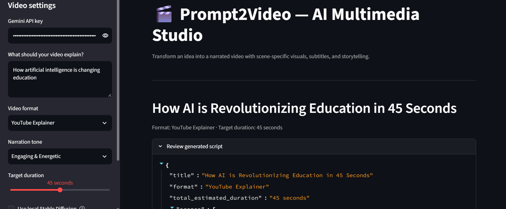
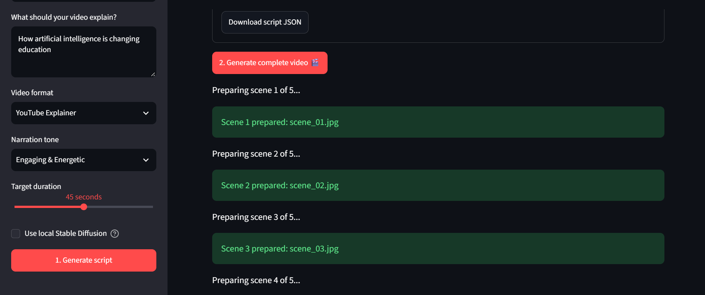
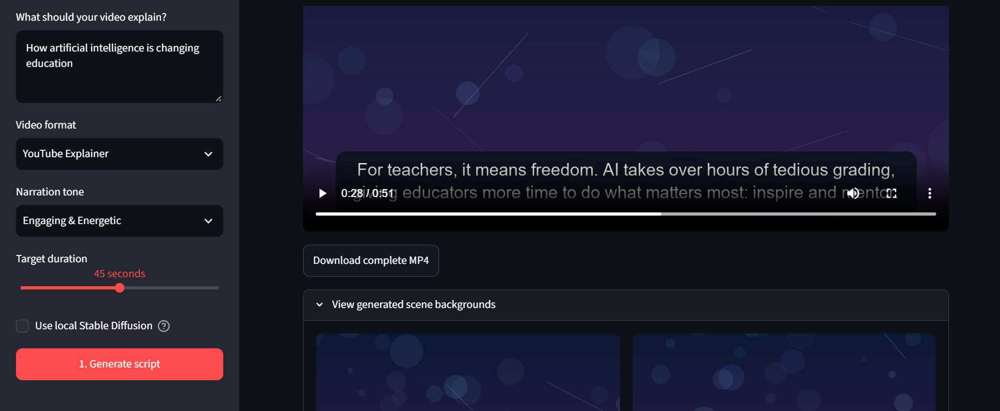

# 🎬 Prompt2Video — AI Multimedia Studio (WIP)

> **⚠️ Unfinished Project / Work in Progress**  
> This repository contains an experimental local multimedia application[cite: 3, 4]. Features are actively evolving, and parts of the system are still under development.

---

## 🚀 About the Project

**Prompt2Video** is a local Streamlit application designed to transform simple text prompts into fully narrated, multi-scene videos equipped with synchronized audio voiceovers, scene-specific backgrounds, and clean subtitle overlays.

### 🛠️ Tech Stack
* **Frontend:** Built with Streamlit.
* **Script Generation:** Powered by the Google Gemini API using `gemini-3.8-flash`[cite: 3].
* **Video Rendering:** Handled by MoviePy 2.x[cite: 3].
* **Visual Asset Engine:** Features optional local Stable Diffusion (`OFA-Sys/small-stable-diffusion-v0`) via PyTorch along with an offline procedural visual fallback generator.
* **Text-to-Speech (TTS):** Utilizes `pyttsx3` for offline narration[cite: 4, 5].

---

## 📸 Application Preview

### 1. Script Configuration & Generation
Users can configure video formatting, narration tone, and target duration in the sidebar, input any topic, and generate a structured scene-by-scene script.
<p align="center">
  
</p>

### 2. Full Video Rendering Pipeline
Once the script is reviewed, clicking the generation button runs scene-by-scene compilation, building assets, generating narration tracks, and stitching clips together via MoviePy.
<p align="center">
  
</p>

### 3. Playback & Export
The completed video displays directly in the app interface with styled subtitle boxes, alongside options to download the final MP4 or view generated individual scene assets[cite: 3, 7].
<p align="center">
  
</p>

---

## 📂 Project Structure

* `app.py` : Main Streamlit web application and orchestration logic[cite: 3].
* `asset_gen.py` : Visual generation module supporting local Stable Diffusion and algorithmic fallback routines[cite: 4].
* `requirements.txt` : Python package dependencies including Streamlit, Google GenAI, MoviePy, Pillow, and pyttsx3[cite: 5].
* `video_projects/` : Local output directory for cached media, audio, and compiled videos[cite: 3].

---

## ⚙️ Installation & Setup

1. **Clone the repository:**
   ```bash
   git clone [https://github.com/votre-nom-utilisateur/prompt2video.git](https://github.com/votre-nom-utilisateur/prompt2video.git)
   cd prompt2video
